# ZEHN — Test Report

Generated 2026-11-15T16:50:32.352Z by `node tools/report.mjs` from `e2e/out/report.json` (e2e started 2026-11-15T16:20:09.978Z).
Environment: headless Chromium (Playwright) with **SwiftShader software WebGL** (no GPU), file:// URL, all network requests blocked except file:/data:/blob:.

## Unit tests (`npm test`)

188 passed, 0 failed (188 tests). Statistics are compared with SciPy goldens (`tools/golden.py`, `test/golden/*.json`) at ≤ 1e-8 tolerance (gate G4 requires 1e-4).

## G3 — Minimums (`npm run count`)

| Item | Benchmark | ZEHN minimum | ZEHN actual | Pass |
|---|---|---|---|---|
| Runnable paradigms | 0 | 36 | 38 | ✅ |
| Dashboard panels (implemented) | 25 | 34 | 39 | ✅ |
| Quiz questions | 142 | 320 | 336 | ✅ |
| Glossary terms | 317 | 420 | 868 | ✅ |
| AI intents | 84 | 130 | 289 | ✅ |
| Tour beats | 21 | 32 | 34 | ✅ |
| Decision events / dilemmas (+IRB) | 38 | 56 | 79 | ✅ |
| Simulated client cases | 0 | 20 | 26 | ✅ |
| Missions (core) | 0 | 16 | 16 | ✅ |
| Case studies with sources | 0 | 14 | 19 | ✅ |
| Modes | 5 | 7 | 7 | ✅ |
| Expressive face AUs | 0 | 14 | 16 | ✅ |
| Facts (facts.json) | 0 | 0 | 91 | ✅ |

G3 PASS

## End-to-end summary

| Check | Result |
|---|---|
| Boot | 4515 ms; services: ui✓ runner✓ audio✓ engine✓ renderer✓ input✓ controls✓ world✓ ai✓ chat✓ clinic✓ scoring✓ missions✓ director✓ tour✓ journey✓ |
| Console errors / page errors | 0 / 0 |
| Blocked network requests (offline, G8) | 0 |
| Page crash | none |
| WASD walk + mouse look | OK (walked 1.92 m, look Δ 1.41 rad) |
| Modes visited | 7 / 7 |
| Zones visited | 10 / 10 |
| Panels opened (with APA+domain+HEC+week tags) | 39 (39 with 4 tags) |
| Buttons pressed / dead buttons | 944 / 0 |
| Paradigms run by bot + CSV schema valid | 38 / 38 |
| Dilemmas / IRB resolved | 62 / 17 (events 62 / 17) |
| Clinic full session | completed |
| Crisis phrases → crisis card (G14) | 30 / 30 |
| Save/load round-trip (G9) | OK |
| Downloads triggered (CSV/JSON/PNG/MD) | 15 |

### Dead-button audit

No dead buttons detected (every click changed the DOM, emitted a bus event or produced a download).

### Paradigms (bot participant, quick mode)

| Paradigm | Rows | Schema | First result line |
|---|---|---|---|
| stroop | 26 | valid | Mean correct RT — congruent 80 ms, neutral 84 ms, incongruent 94 ms |
| flanker | 26 | valid | Mean RT: congruent 68 ms, neutral 74 ms, incongruent 71 ms |
| go_nogo | 32 | valid | Commission errors (pressed on X): 16.7% |
| muller_lyer | 7 | valid | PSE error (matched − true length, % of true): fins-in -8.0%, fins-out 18.2%, control 0.7% |
| ponzo | 16 | valid | PSE (lower-bar % difference judged equal): rails 6.0%, no rails -1.7% |
| ames | 8 | valid | Mean rated ÷ true size ratio: peephole 1.90×, revealed 1.14× |
| jnd_staircase | 26 | valid | Standard 80 px: JND ≈ 8.0 px (ΔI/I = 0.100), 0 reversals over 8 trials |
| magnitude_est | 13 | valid | Simulated exponent a = 0.75 (ψ = k·φᵃ, fitted by log–log regression; k = 100.4, R² = 0.95) |
| sdt_yesno | 26 | valid | liberal: H = .90, FA = .50 → d′ = 1.28, c = −0.64 (log-linear corrected); optimal β for th |
| hick_hyman | 26 | valid | n = 1 (1.00 bits): mean correct RT 47 ms, accuracy 100% |
| fitts | 20 | valid | ID table (ID = log₂(2D/W)): |
| mental_rotation | 16 | valid | "Same" trials: RT = 137 + 0.69·angle ms (slope 0.69 ms/deg ≈ 1446 deg/s, R² = 1.00) |
| visual_search | 26 | valid | Feature search, target present: slope 0.4 ms/item (RT 4:91, 8:83, 16:94 ms) |
| posner | 22 | valid | Central (arrow) cue: valid -212 ms, invalid -201 ms → validity effect 10 ms |
| attn_blink | 14 | valid | X detection given the red letter was correct (T2/T1) by lag: lag 1 50%, lag 2 100%, lag 3  |
| dichotic | 12 | valid | Attended ear — chirp detected: 50% |
| inattentional_blindness | 4 | valid | Counting: 50% of clips exactly right; mean absolute error 0.75 passes. |
| change_blindness | 7 | valid | Mode: flicker. Correct object identified on 83% of scenes. |
| serial_position | 6 | valid | Lists: 6. Mean words recalled per list: 4.5 of 12. |
| brown_peterson | 7 | valid | Trigram recalled perfectly (in order): 3 s 100%, 9 s 50%, 18 s 0% |
| levels_processing | 20 | valid | Structural questions: hit rate 100%, d′ 2.43 |
| drm | 21 | valid | "Old" responses — studied words (hits): 67%; critical lures (never shown): 33%; unrelated  |
| misinformation | 4 | valid | Your question used the verb "hit". Your speed estimate: 55.0 km/h; broken glass reported:  |
| nback | 24 | valid | Hits 1/2 (50%), false alarms 0/20 (0%). |
| memory_palace | 4 | valid | Rote rehearsal: 40% of words recalled (1 list). |
| classical_cond | 14 | valid | Anticipatory responses (CRs) — acquisition: first half 33%, second half 33% |
| operant_schedules | 8 | valid | FR 5: 141 presses/min over 2 block(s), 8 points |
| shaping | 18 | valid | Reinforcement decisions correct: 88% (16 trials) |
| hanoi | 5 | valid | Puzzle 1 (3 discs): 9 moves vs optimal 7 — efficiency 78%, 0.1 s per move |
| wason | 6 | valid | Correct (P and not-Q only): abstract 0%, familiar social rule 0% |
| framing | 6 | valid | % risky choice — gain frame: 67%, loss frame: 67% |
| anchoring | 6 | valid | jar: estimate 260 (true 340; low anchor 100) |
| conservation | 8 | valid | Coding accuracy vs expert key: 88% (8 answers) |
| false_belief | 8 | valid | Simulated data — false-belief pass rate by age: 3 y 0% (n=1), 4 y 0% (n=1), 5 y 100% (n=2) |
| asch | 9 | valid | Critical trials (group unanimously wrong): you agreed with the group on 1 of 6 (17% confor |
| prisoners_dilemma | 15 | valid | Kiran (Tit-for-tat): you 9 – 9 them over 3 rounds; you cooperated 100% |
| ipip_big5 | 10 | valid | For learning only, not a diagnosis. Scores are descriptive averages and are not interprete |
| face_recognition | 16 | valid | Overall accuracy: 36% (14 faces; chance = 14%) |

## G7 / G13 — Performance and timing per tier

Measured in headless Chromium on **SwiftShader (CPU software rasteriser)**, 1280×720. These FPS figures are a lower bound and are NOT representative of a discrete or integrated GPU; G7 (≥60 fps High on a discrete GPU, ≥30 fps Medium integrated) cannot be verified in this environment and must be measured on real hardware.

| Tier | rAF fps | engine fps | draw calls | triangles | onset median (frames) | onset p95 (frames) | RT resolution (ms) | G13 |
|---|---|---|---|---|---|---|---|---|
| low | 2.0 | 10.9 | 115 | 129451 | 0.02 | 0.03 | 0.100 | ✅ PASS (n=500) |
| medium | 6.7 | 30.0 | 115 | 129451 | 0.02 | 0.04 | 0.100 | ✅ PASS (n=500) |
| high | 2.4 | 14.8 | 115 | 129451 | 0.02 | 0.03 | 0.100 | ✅ PASS (n=500) |
| ultra | 0.7 | 20.5 | 115 | 129451 | 0.02 | 0.05 | 0.100 | ✅ PASS (n=500) |

### Onset-error histogram (|onset_actual − onset_req| in frames, tier low)

```
0.00–0.25 f | ████████████████████████████████████████ 489
0.25–0.50 f |  0
0.50–0.75 f |  0
0.75–1.00 f |  0
1.00–1.25 f |  0
1.25–1.50 f |  1
1.50–1.75 f |  0
1.75–2.00 f | █ 10
```

The UI states on every consent and results screen that browser RTs include a fixed lag of tens of milliseconds (Bridges et al., 2020, *PeerJ* 8:e9414).

## G6 — Soak

600 s cycling zones/modes and social-model runs; JS heap 68.0 → 68.0 MB after forced GC (growth 0.00%; gate < 10%: ✅ PASS).

## Screenshots

31 screenshots at deviceScaleFactor 1 in `docs/screenshots/` (copied from e2e/out): 00_boot_courtyard.png, clinic_session.png, mode_clinic.png, mode_director.png, mode_neuro.png, mode_participant.png, mode_social.png, mode_tour.png, mode_walk.png, panel_bio.png, panel_emotion.png, panel_replication.png, panel_sdt.png, panel_stats.png, tier_high.png, tier_low.png, tier_medium.png, tier_ultra.png, time_day.png, time_dusk.png, time_night.png, zone_childdev.png, zone_clinic.png, zone_courtyard.png, zone_explab.png, zone_learning.png, zone_library.png, zone_mohalla.png, zone_neuro.png, zone_sleep.png, zone_wundt.png.

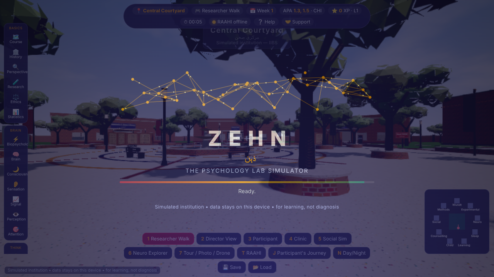
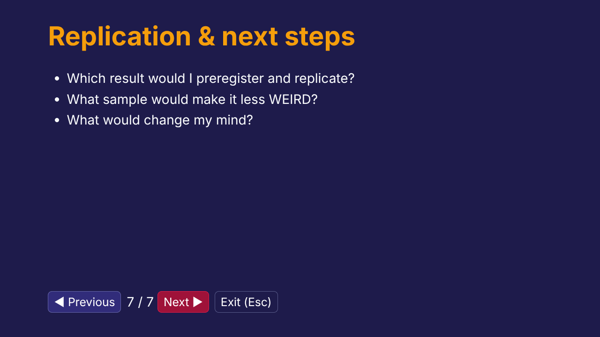
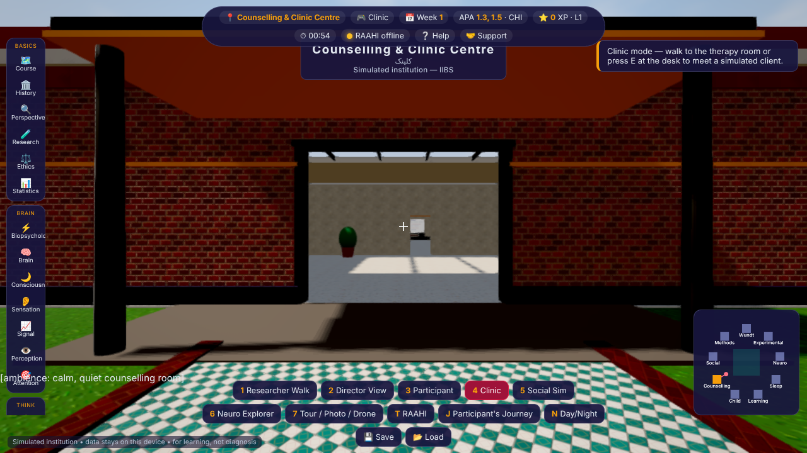
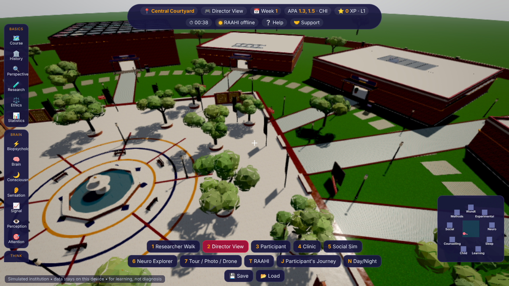
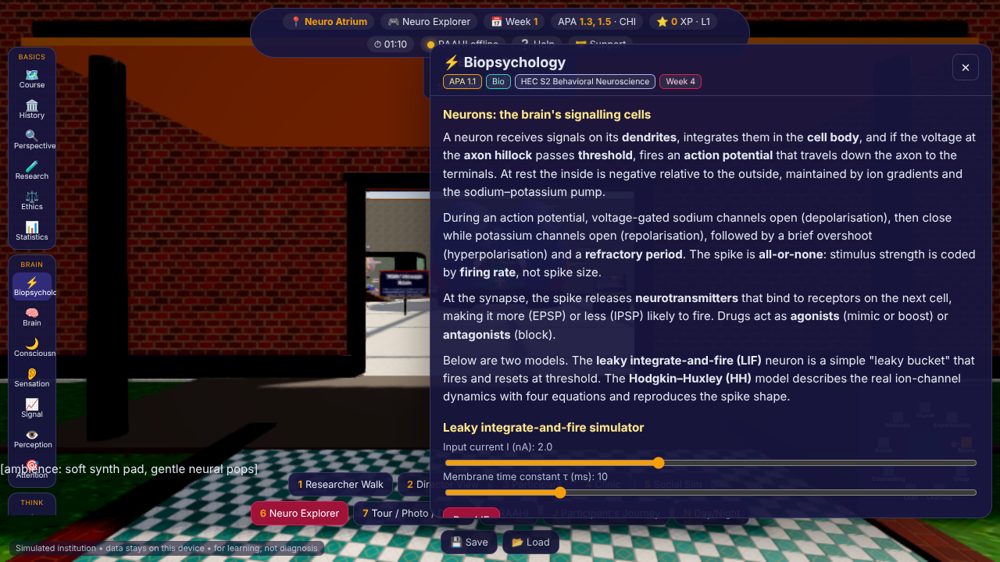
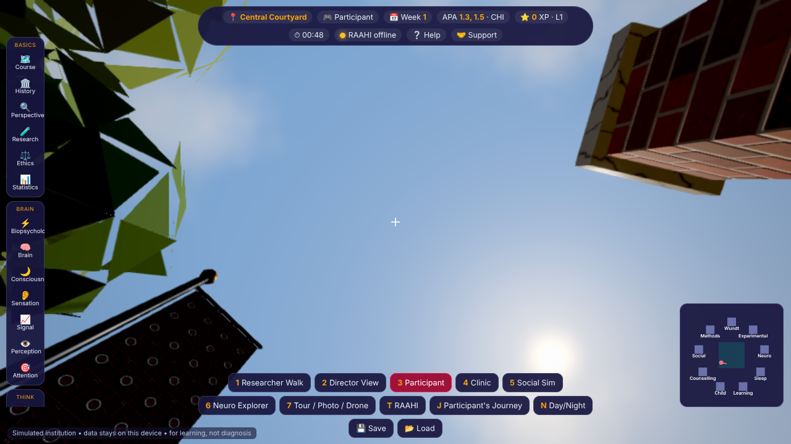
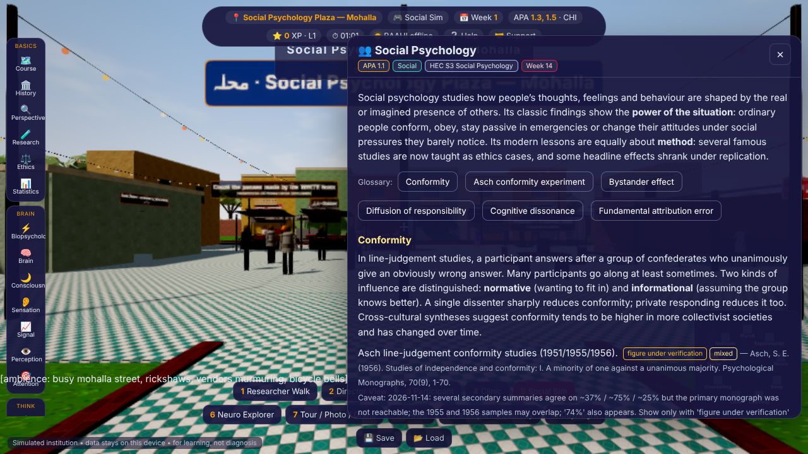
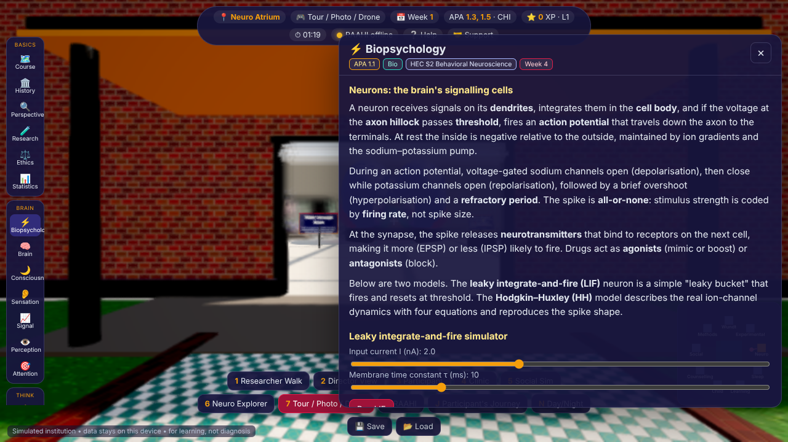
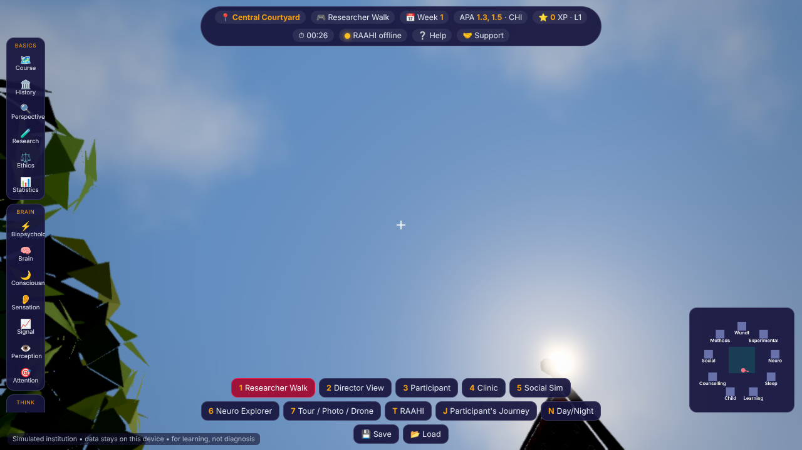
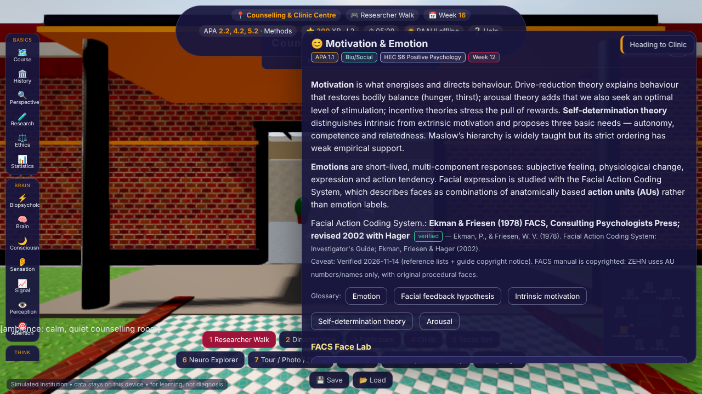
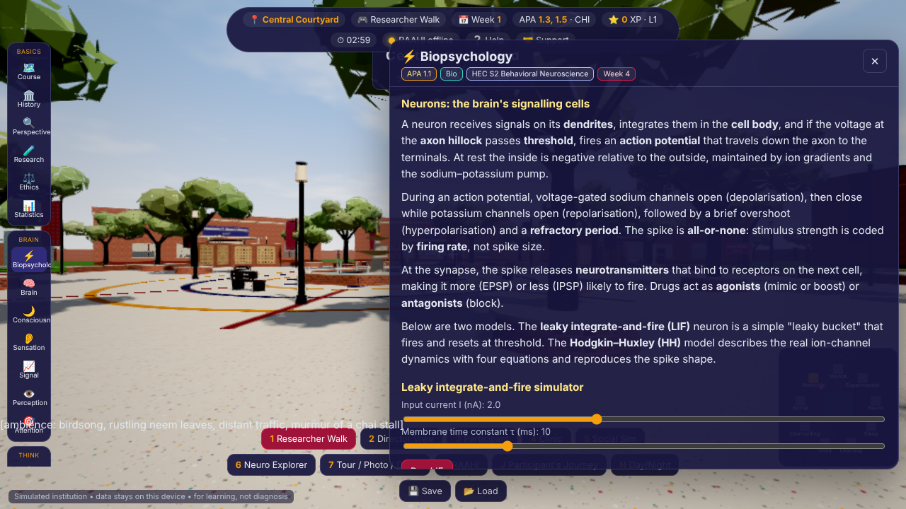
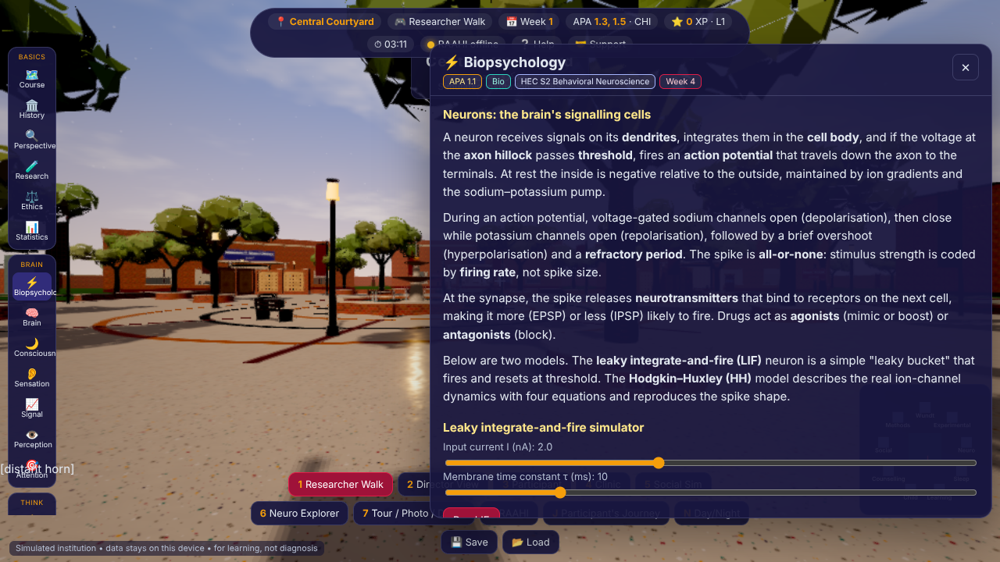
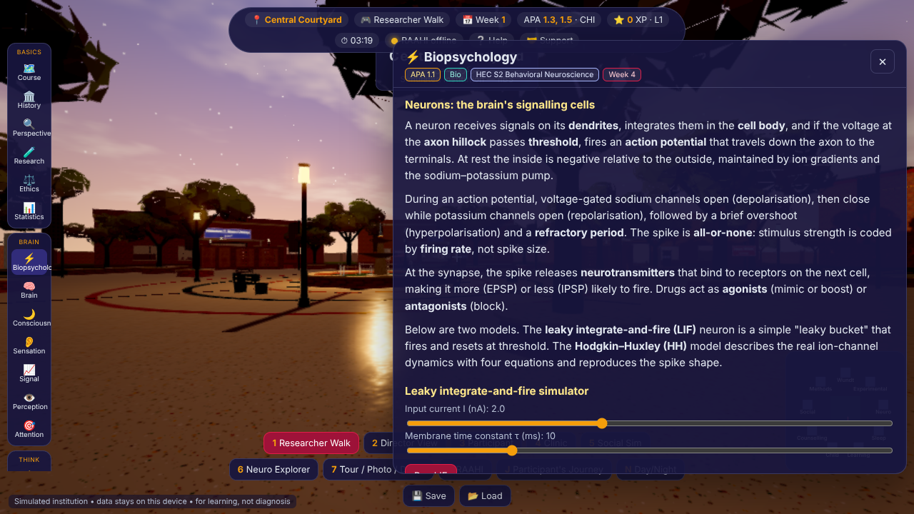
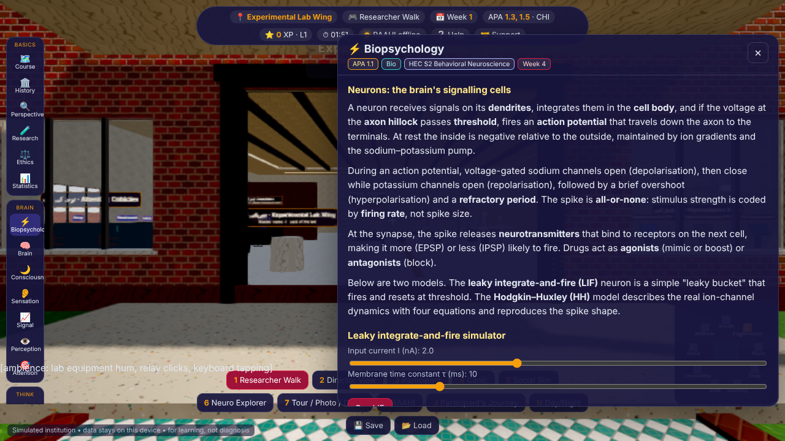
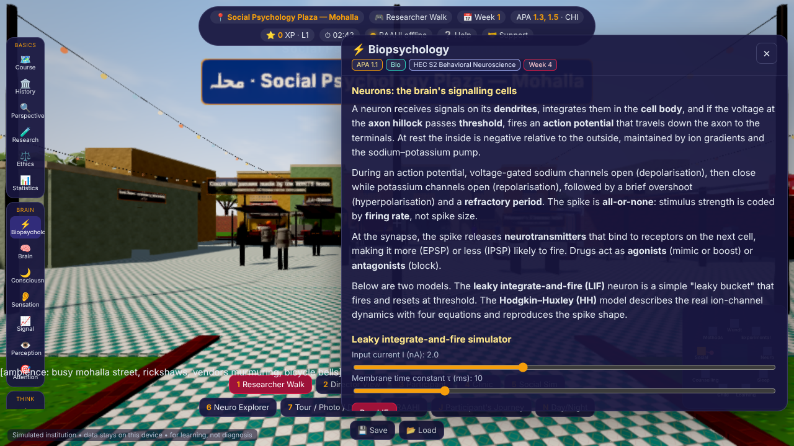
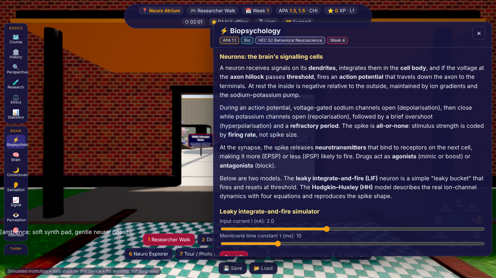
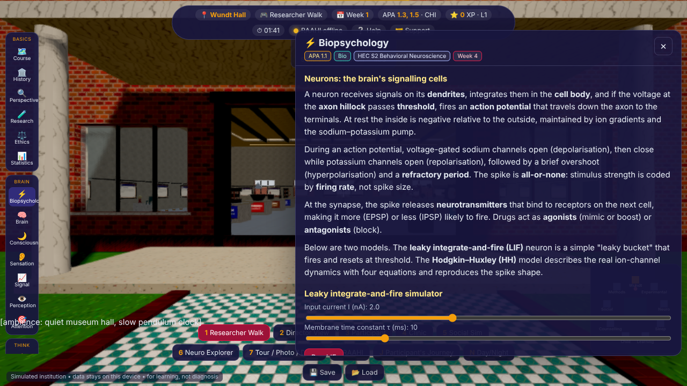

